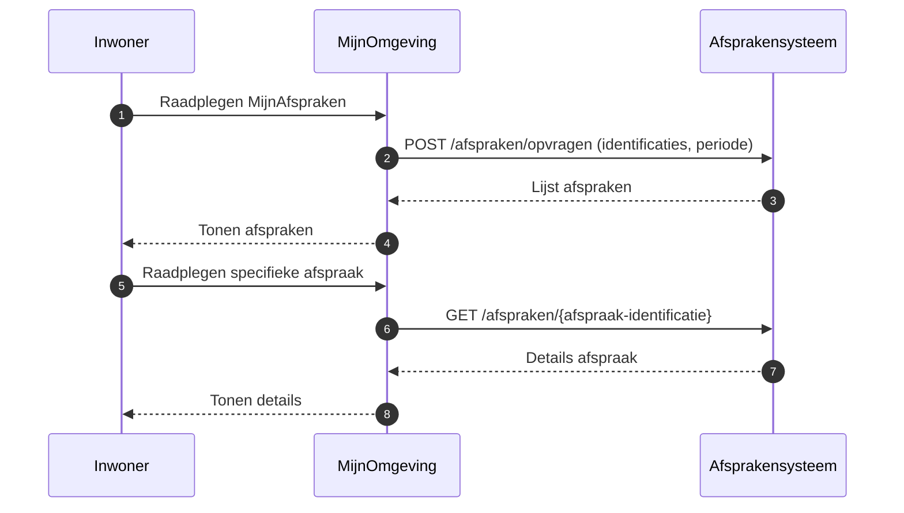
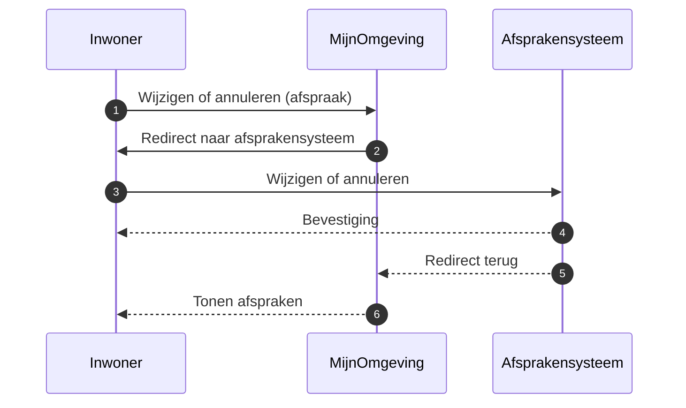

# Gebruikspatronen

Bron: "MijnAfspraken: Algemeen afspraken" (Eerste Concept). De uitgangspunten daarin die de API raken:

- Het afsprakensysteem is de bron; er is geen apart afsprakenregister (Common Ground: eenmalig vastleggen, meervoudig gebruik).
- Een gemeente heeft één afsprakensysteem. Meerdere systemen vragen een converterlaag; die valt buiten scope.
- Een initiële afspraak maakt de inwoner rechtstreeks in het afsprakensysteem. Dat is geen taak van MijnAfspraken.
- Afspraken worden gevonden op een gevalideerd e-mailadres of telefoonnummer, zie [ADR 0001](adr/0001-client-credentials-security.md). Het brondocument noemt BSN en KvK-nummer; dat is vervallen.

## Raadplegen

POST wordt gebruikt zodat de identificatie niet in een URL of log terechtkomt.

## Wijzigen of annuleren (buiten scope van de API)

De MijnOmgeving is alleen vertrek- en eindstation. De inwoner wijzigt of annuleert in het afsprakensysteem zelf:

Hiervoor ontbreekt in model en spec een URL-attribuut en een terugkeer-URL (zie issue).

## Consequenties voor de weergave

- Per vorm toont de MijnOmgeving andere gegevens: online een link, fysiek een locatie, telefonisch het nummer waarop de gemeente belt.
- `aanduidingWatMeeTeNemen` is markdown en moet veilig worden gerenderd.
- Het telefoonnummer van een telefonische afspraak hoeft niet altijd getoond te worden (het model zegt dat expliciet).
